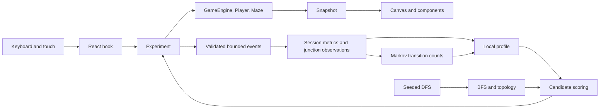

<h1 align="center">aMAZE!</h1>

<p align="center"><strong>The maze is learning. Are you?</strong></p>

<p align="center">
  
  
  
  
  
</p>

## What if the maze learned how you think?

You're a human aboard a research vessel, navigating chambers designed by **Vey**, an original alien scientist inspired by the curiosity and enthusiasm in *Project Hail Mary*. Vey observes how you navigate, from wall collisions to the turns you take at junctions. Those observations can shape later chambers. After an experiment, the research report shows what was measured and why the layouts you played were selected.

> **Active development**
>
> The technical MVP is implemented, including the playable campaign, procedural generation, behavioral data pipeline, statistical predictions, and local progress. The immersive redesign adds a pixel-art title, a playable first encounter, stage-specific spacecraft chambers, and Vey’s research journal. Visual polish and device testing are ongoing.

[View gameplay screenshots](docs/SCREENSHOTS.md)

## The five experiments

| Stage | What happens |
| --- | --- |
| **First Contact** | Find the gold exit in a 7 × 7 chamber and establish a baseline. |
| **Observation** | Navigate a 9 × 9 chamber and provide more opportunities to observe junction decisions. |
| **Adaptation** | Enter an 11 × 11 chamber where the adaptive mode begins scoring layouts against your profile. |
| **Outsmart** | Try a different strategy in a 13 × 13 chamber while the model compares confident forecasts with subsequent decisions. |
| **Amaze** | Complete the 15 × 15 challenge, review the final summary, or continue with fresh Amaze layouts. |

## What the project demonstrates

| Discipline | Implementation |
| --- | --- |
| **Software engineering** | A TypeScript engine owns collision rules and game state. React renders snapshots and sends commands back through a hook. Canvas, CSS, and optional Web Audio handle presentation. |
| **Data engineering** | Validated gameplay events feed a bounded in-memory stream, session metrics, and a versioned browser-local profile. |
| **Graph algorithms** | Breadth-first search verifies reachability, finds the shortest path, and supports topology analysis and single-step hints. |
| **Statistical learning** | A first-order Markov model learns relative turns at junctions, evaluates predictions before updating, and abstains when evidence is weak. |
| **Procedural generation** | Seeded, iterative randomized depth-first search produces reproducible connected layouts. A scoring function selects among solvable candidates in adaptive stages. |

## From gameplay to the next maze

1. **Capture and validate.** Movement commands become structured events with session and level IDs, a sequence number, a timestamp, positions, and an outcome. A ring buffer keeps the latest 256 raw events in memory.
2. **Aggregate.** The session tracks collisions, revisits, backtracking, dead-end recovery, timing, junction choices, and route efficiency. Collision rate is collisions divided by all movement attempts. Route efficiency is BFS-optimal moves divided by actual successful moves.
3. **Learn.** At junctions, the model uses the previous junction decision to estimate the next relative turn (left, right, straight, or reverse). For each legal turn, add-one Laplace smoothing divides its count plus one by the sum of legal counts plus the number of legal options. Sparse conditional rows fall back to marginal counts. The model abstains when it lacks sufficient samples or when its top two choices are too close. It scores each prediction before learning from the actual decision.
4. **Select.** In Observation, adaptive mode checks up to five seeded layouts for a junction on the shortest route, allowing at most six extra moves versus the original layout. From Adaptation onward, adaptive mode generates nine candidates using seeded DFS and checks them with BFS. It scores solvable layouts by distance from a target route length, dead-end cost, and whether the optimal route diverges from confident predictions. Recent completion performance nudges difficulty within bounds. The selected layout stays fixed during play.
5. **Explain.** The research report shows route efficiency, revisits, turn tendencies, prediction results, and selection history. Model-based results appear after their sample thresholds are met.

### Architecture



See the [architecture guide](docs/ARCHITECTURE.md) and [contributor instructions](CONTRIBUTING.md) for module boundaries and workflow. See [LEARNING.md](LEARNING.md) for worked examples and complexity analysis, and [DEVELOPMENT.md](DEVELOPMENT.md) for implementation decisions and validation.

## Run locally

Use Node.js 24 and npm.

```sh
git clone https://github.com/Heena2135/aMAZE.git
cd aMAZE
npm ci
npm run dev
```

Open the URL Vite prints. For a production preview, run `npm run build` followed by `npm run preview`.

### Play

1. Choose **New Game** or **Continue**, then begin the experiment. Move the lavender player to the gold exit with the arrow keys, WASD, or the on-screen directional buttons.
2. Pause with Escape or the pause button. Restart restores the current layout and resets the live counters. The optional hint marks one tile along the shortest remaining route.
3. After winning, prepare the next experiment. Advancing requires completing the current stage and meeting a junction observation threshold, reaching 75% route efficiency, or completing a second fresh layout in that stage. Unlocked stages can be replayed.
4. Select **Standard** in Settings to compare layouts generated independently of your profile. Gameplay in either mode can contribute observations to the local profile.

## Data and privacy

The game uses no login, backend, external tracking, or external AI service. Settings, aggregate metrics, model counts, and a bounded history are saved for this browser origin. In-progress games and raw event logs are session-only. Settings can export a JSON report, reset the learning model and adaptive difficulty, or clear all progress. If storage access fails, the game continues in memory.

## Testing and deployment

```sh
npm run typecheck
npm run lint
npm test
npm run build
```

GitHub Actions runs these checks after a clean install. Relative asset URLs let the production build work under a GitHub Pages repository subpath. To publish after approval, configure Pages to use GitHub Actions and manually run **Publish aMAZE! to Pages** with its publish input enabled. The workflow has no automatic deployment trigger. [GitHub Pages workflow guide](https://docs.github.com/en/pages/getting-started-with-github-pages/using-custom-workflows-with-github-pages)

## Limits and development roadmap

- **Implemented:** Five playable stages, seeded generation, BFS validation, gameplay analytics, Markov prediction, adaptive selection, and local persistence.
- **In progress:** Visual polish and physical-device testing for the spacecraft scenes and controls.
- **Future work:** Compare the model against a legal-choice baseline, add a nonvisual route interface, and validate usability on physical devices.

The model uses a small set of junction states, so it can confound maze geometry with player preference. Reported hit rate covers only the decisions the model chose to predict. Personal bests are grouped by maze size and mode, so they compare different layouts. Progress is specific to the browser origin, and interrupted experiments do not resume after reload. Canvas exposes player, exit, and hint coordinates through an accessible label. Full nonvisual maze navigation is still a planned improvement.

## Author

**Heena Patel**

Computer Science — Data Engineering, Sheridan College

[GitHub](https://github.com/Heena2135) · [LinkedIn](https://linkedin.com/in/heena-s-patel)
