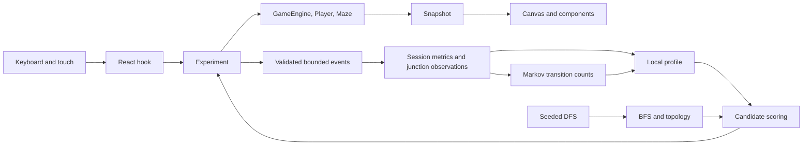

# aMAZE!

**The maze is learning. Are you?**

You are a human aboard a research vessel. Vey, an original alien scientist inspired by the curiosity and enthusiasm in *Project Hail Mary*, observes your navigation and chooses new challenges. Solve five experiment stages and open the research report to see what the system measured and why a future layout was selected.

## Run locally

Use Node.js 24 and npm. The Vite application is the `maze-that-learns` directory.

```sh
cd maze-that-learns
npm ci
npm run dev -- --port 5174
```

Open the URL Vite prints. For a production preview, run `npm run build` and `npm run preview`.

## Play

1. Enter the laboratory and begin the experiment. Move the lavender player to the gold exit with arrow keys, WASD, or the directional buttons.
2. Pause with Escape or the pause button. Restart restores the current layout and clears its live counters. An optional hint marks one tile along the shortest remaining route.
3. Prepare the next experiment after winning. Stages advance with a clear and either evidence, strong route efficiency, or a second clear of that stage. Previously unlocked stages can be replayed with fresh layouts.
4. Compare with Standard mode in Settings. It generates a seeded layout independent of your profile. Gameplay in either mode can contribute observations to the local profile. Adaptive selection begins in Adaptation.
5. Open the report for route efficiency, revisits, turn tendencies, prediction results, and the selection history. Claims based on model samples appear after the displayed thresholds.

## Architecture and algorithms

React and TypeScript connect a Vite application to Canvas rendering, CSS, optional Web Audio sound, and LocalStorage. ESLint checks the source and Vitest runs deterministic tests.



- **Generation:** iterative randomized DFS carves connected mazes using a deterministic seed. BFS validates reachability, measures optimal movements, and powers single-step hints.
- **Analytics:** movement commands become validated gameplay events. The session aggregates collisions, revisits, recovery time, junction choices, timing, and efficiency. The current session retains the latest 256 raw events in memory.
- **Learning:** a first-order Markov model predicts relative turns from the previous junction decision. Legality masking and Laplace smoothing give legal choices nonzero probability. The model falls back to marginal counts for sparse rows and abstains without enough evidence or separation. It scores a prediction before learning from the actual choice.
- **Adaptation:** nine solvable candidates are scored on distance from a target route length, dead-end cost, and whether the optimal route diverges from confident predictions. Recent completion performance nudges the target difficulty within bounds. The layout stays fixed during play.
- **Progression:** First Contact, Observation, Adaptation, Outsmart, and Amaze move from baseline collection to calibrated challenges. Completing Amaze unlocks additional Amaze layouts.

Read [LEARNING.md](LEARNING.md) for worked examples and complexity, and [DEVELOPMENT.md](DEVELOPMENT.md) for implementation decisions and validation.

## Data and privacy

No login, backend, external tracking, or external AI service is used. The game saves settings, aggregate metrics, model counts, and a bounded history on this browser origin. In-progress games and raw event logs are session-only. Settings can export a JSON report, reset the model and adaptive difficulty, or clear all progress. If storage access fails, the game continues in memory.

## Checks

```sh
npm run typecheck
npm run lint
npm test
npm run build
```

The checked-in CI workflow runs these checks after a clean install. For Pages, use this application directory as the repository root. Relative asset URLs let the build work under a repository subpath. After approval, configure Pages to use GitHub Actions and manually run **Publish aMAZE! to Pages** with its publish input enabled. The workflow has no automatic deploy trigger. See [GitHub’s Pages workflow guide](https://docs.github.com/en/pages/getting-started-with-github-pages/using-custom-workflows-with-github-pages).

## Screenshot placeholders

- Opening title and research vessel window
- Active maze and researcher terminal
- Research report and five-stage progression

## Limits and future improvements

The Markov model uses a small set of junction states and can confound maze geometry with preference. Its measured hit rate applies to predictions it chose to make. Personal bests group by size and mode, so they compare different layouts. A browser or origin change starts with a new profile, and interrupted experiments are not resumed. The Canvas supplies coordinates and hint information via an accessible label, but the application does not yet provide a full nonvisual map. Future work could compare the model against a legal-choice baseline, add a nonvisual route interface, and validate usability on physical devices.
