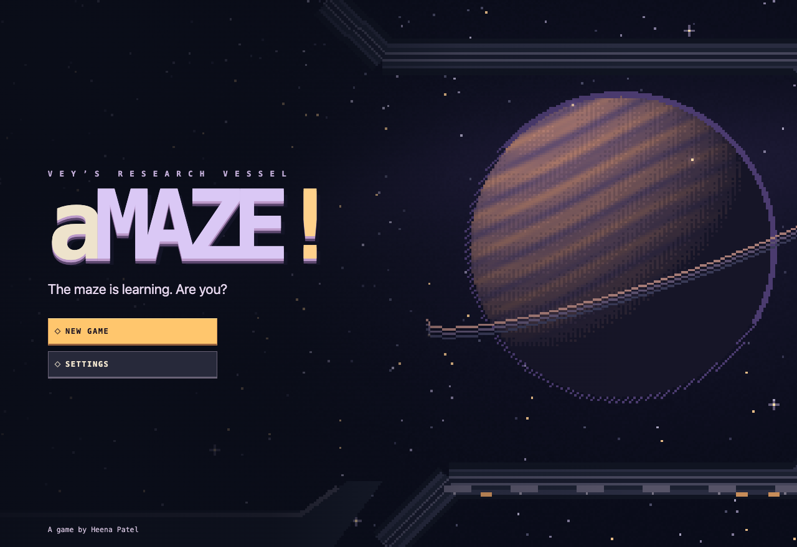
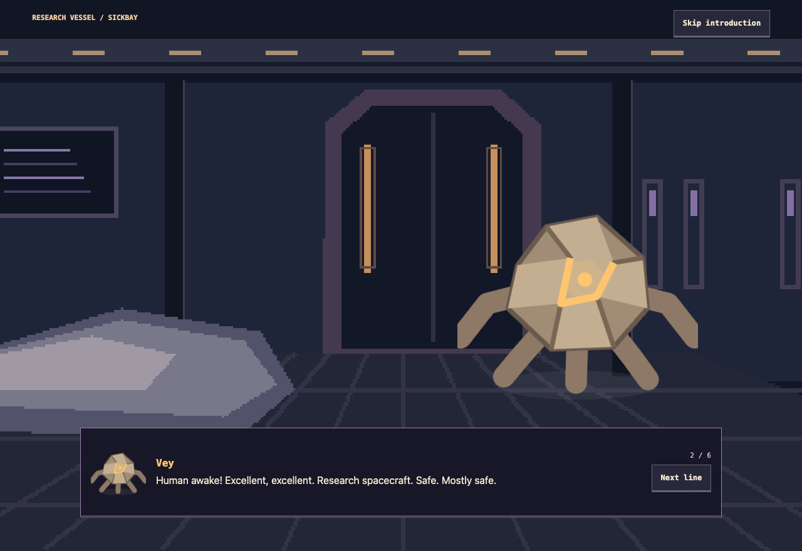
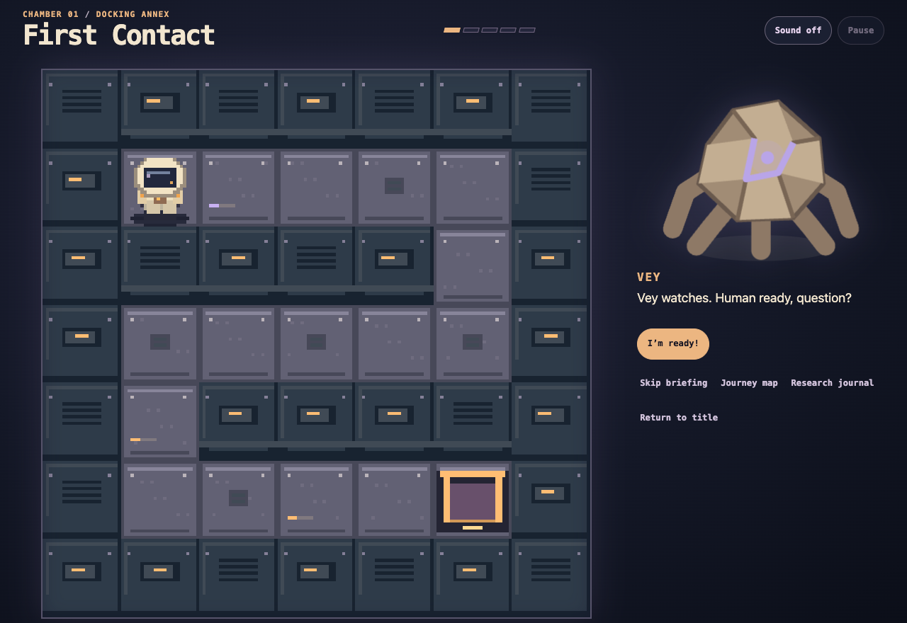
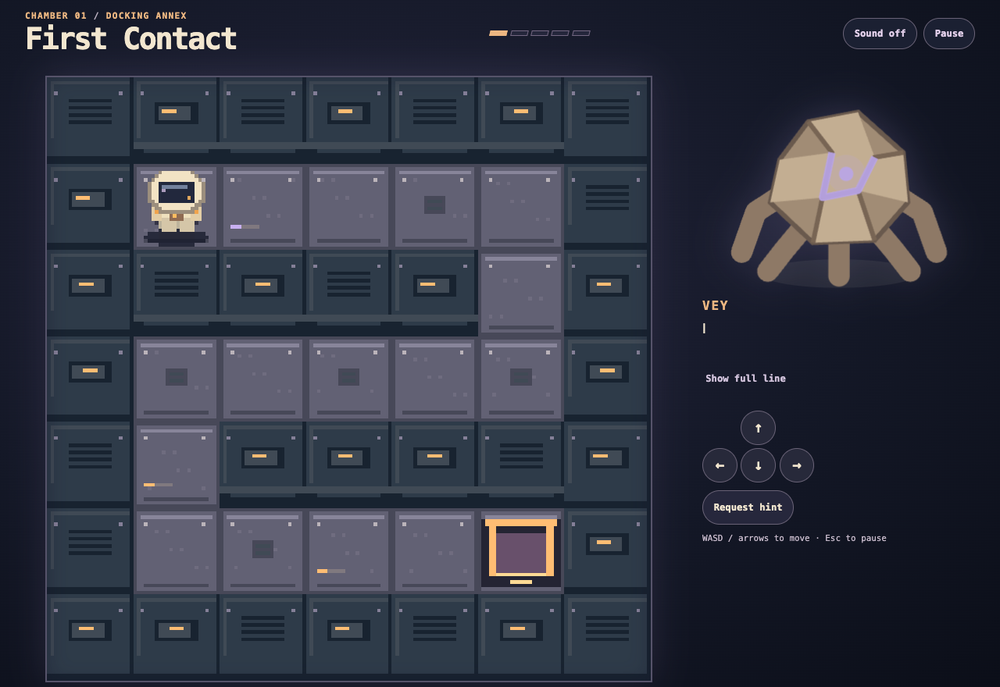

# aMAZE! screenshots

Captured in headless Chrome from the production build served locally under `/amaze/`. Desktop captures use a 1280 × 880 viewport; the mobile capture uses a 390 × 844 viewport at 3× density.

## Title

## First encounter

## Chamber dialogue

## First Contact

## Other views

- [Journey map](screenshots/journey-map.png)
- [Mobile gameplay](screenshots/mobile-gameplay.png)
- [Research journal](screenshots/research-journal.png)
- [Amaze ending](screenshots/ending.png)
